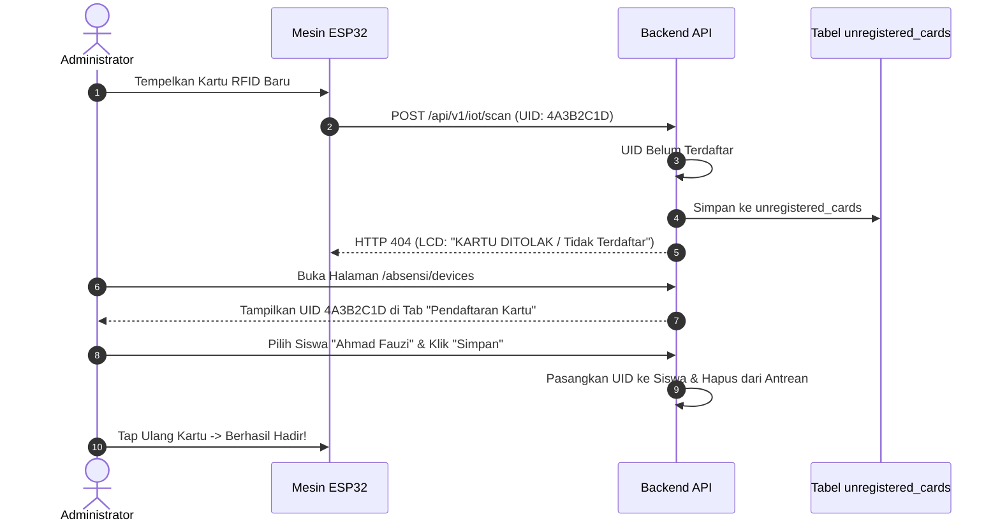

# 🎓 Panduan Integrasi Data Siswa, Karyawan & Monitoring Mesin IoT

Dokumentasi ini menjelaskan langkah demi langkah cara menghubungkan database **Siswa (Sekolah / Madrasah)** atau **Karyawan / Pegawai (Perusahaan / Kantor)** yang sudah ada di sistem Anda ke mesin absensi fisik **Smart Box ESP32**, serta cara mengelola **Monitoring Mesin & Pengaturan Lembaga**.

---

## 📑 DAFTAR ISI

- [1. Prinsip Kerja Identifikasi Pengguna](#1-prinsip-kerja-identifikasi-pengguna)
- [2. Opsi 1: Menambahkan Kolom ke Tabel Siswa / Karyawan Eksisting](#2-opsi-1-menambahkan-kolom-ke-tabel-siswa--karyawan-eksisting)
- [3. Opsi 2: Menggunakan Database VIEW (Tanpa Mengubah Struktur Kode Lama)](#3-opsi-2-menggunakan-database-view-tanpa-mengubah-struktur-kode-lama)
- [4. Opsi 3: Kustomisasi Query Pencarian di Backend](#4-opsi-3-kustomisasi-query-pencarian-di-backend)
- [5. Alur Registrasi Kartu Baru (Card Enrollment)](#5-alur-registrasi-kartu-baru-card-enrollment)
- [6. Pengaturan Nama Sekolah / Lembaga & Pesan Standby LCD 16x2](#6-pengaturan-nama-sekolah--lembaga--pesan-standby-lcd-16x2)
- [7. Dashboard Monitoring Kesehatan Mesin IoT & Sinyal WiFi RSSI](#7-dashboard-monitoring-kesehatan-mesin-iot--sinyal-wifi-rssi)

---

## 1. Prinsip Kerja Identifikasi Pengguna

Saat pengguna menempelkan kartu RFID atau mengarahkan kode QR ke mesin:

1. Mesin ESP32 mengirim parameter `code` ke endpoint `POST /api/v1/iot/scan`.
2. Backend Anda memeriksa database: **Apakah ada pengguna yang memiliki kode ini?**
   - Nilai `code` dapat dicocokkan dengan:
     - UID Kartu RFID (Hexadecimal, misal: `A1B2C3D4`)
     - String Barcode / QR Code (misal: `SISWA-2026-001` atau `NISN-00192831`)
     - Nomor Induk (NISN Siswa, NIP Guru, NIK Karyawan)
3. Jika ditemukan, sistem mencatat presensi masuk/pulang dan mengembalikan balasan ramah LCD:

```json
{
  "success": true,
  "status": "Hadir",
  "nama": "Ahmad Fauzi",
  "kelas": "XII RPL 1",
  "jam": "07:15",
  "message": "Absensi Masuk Berhasil"
}
```

> ⚠️ **Aturan LCD 16x2:** Field `nama` otomatis disingkat menjadi maksimal 16 karakter di baris 1 LCD (contoh: `"Ahmad Fauzi R."`).

---

## 2. Opsi 1: Menambahkan Kolom ke Tabel Siswa / Karyawan Eksisting

Jika Anda sudah memiliki tabel siswa atau karyawan di database MySQL/MariaDB, Anda hanya perlu menjalankan query `ALTER TABLE` berikut:

### A. Untuk Aplikasi Sekolah (Tabel `siswa`)

```sql
ALTER TABLE siswa 
    ADD COLUMN rfid_uid VARCHAR(64) UNIQUE NULL AFTER nama_lengkap,
    ADD COLUMN barcode_uid VARCHAR(64) UNIQUE NULL AFTER rfid_uid,
    ADD INDEX idx_siswa_rfid (rfid_uid),
    ADD INDEX idx_siswa_barcode (barcode_uid);
```

### B. Untuk Aplikasi Perusahaan (Tabel `karyawan` / `pegawai`)

```sql
ALTER TABLE karyawan 
    ADD COLUMN rfid_uid VARCHAR(64) UNIQUE NULL AFTER nama,
    ADD COLUMN barcode_uid VARCHAR(64) UNIQUE NULL AFTER rfid_uid,
    ADD INDEX idx_karyawan_rfid (rfid_uid),
    ADD INDEX idx_karyawan_barcode (barcode_uid);
```

---

## 3. Opsi 2: Menggunakan Database VIEW (Tanpa Mengubah Struktur Kode Lama)

Jika tabel siswa dan guru/pegawai terpisah dan Anda tidak ingin merombak query backend starter kit:

```sql
-- Buat SQL VIEW yang menyatukan Siswa dan Guru ke format standar 'users'
CREATE OR REPLACE VIEW users AS
SELECT 
    id,
    nama_lengkap AS name,
    email,
    rfid_uid,
    barcode_uid,
    nisn AS identifier_number,
    'siswa' AS role,
    nama_kelas AS department,
    is_active,
    created_at,
    updated_at
FROM siswa
LEFT JOIN kelas ON siswa.kelas_id = kelas.id

UNION ALL

SELECT 
    id + 1000000 AS id, -- Offset ID agar tidak tabrakan dengan ID siswa
    nama_lengkap AS name,
    email,
    rfid_uid,
    barcode_uid,
    nip AS identifier_number,
    'pegawai' AS role,
    jabatan AS department,
    is_active,
    created_at,
    updated_at
FROM pegawai;
```

Dengan SQL VIEW di atas, starter kit backend dapat langsung membaca data Siswa dan Pegawai secara otomatis tanpa perlu mengubah tabel aslinya!

---

## 4. Opsi 3: Kustomisasi Query Pencarian di Backend

Jika Anda ingin menyesuaikan langsung di controller backend Anda:

### 🔴 Pada Laravel (`IotAttendanceController.php`)

Ganti query pencarian pengguna pada baris ke-62:

```php
// CONTOH KUSTOM: Mencari di tabel Siswa atau Pegawai
$user = Siswa::where('rfid_uid', $code)
    ->orWhere('barcode_uid', $code)
    ->orWhere('nisn', $code)
    ->first();

if (! $user) {
    $user = Pegawai::where('rfid_uid', $code)
        ->orWhere('barcode_uid', $code)
        ->orWhere('nip', $code)
        ->first();
}
```

### 🐘 Pada PHP Native (`api/scan.php`)

Ganti query SQL pada baris ke-60:

```php
// CONTOH KUSTOM: Query multi-tabel
$stmt = $pdo->prepare('
    SELECT id, nama_lengkap AS name, "siswa" AS role, kelas AS department, is_active 
    FROM siswa 
    WHERE rfid_uid = ? OR barcode_uid = ? OR nisn = ? 
    LIMIT 1
');
$stmt->execute([$code, $code, $code]);
$user = $stmt->fetch();

if (!$user) {
    $stmt = $pdo->prepare('
        SELECT id, nama AS name, "pegawai" AS role, divisi AS department, is_active 
        FROM karyawan 
        WHERE rfid_uid = ? OR barcode_uid = ? OR nik = ? 
        LIMIT 1
    ');
    $stmt->execute([$code, $code, $code]);
    $user = $stmt->fetch();
}
```

---

## 5. Alur Registrasi Kartu Baru (Card Enrollment)

Pengguna sering kali merasa kesulitan mengetikkan manual kode Hex UID RFID (misal: `4A3B2C1D`) ke formulir siswa karena rawan salah ketik.

Sistem ini menyediakan **Mode Registrasi Cepat (Card Enrollment)**:



### Cara Menggunakan di Browser

1. Akses halaman kontrol:
   - **Laravel:** `http://website-anda.test/absensi/devices`
   - **PHP Native:** `https://website-anda.com/devices.php`
2. Buka tab **"Pendaftaran Kartu"**.
3. Di sana akan muncul daftar kartu yang baru saja di-tap di mesin fisik.
4. Pilih nama Siswa atau Karyawan dari dropdown, lalu klik **"Simpan"**.
5. Kartu resmi aktif dan langsung dapat digunakan!

---

## 6. Pengaturan Nama Sekolah / Lembaga & Pesan Standby LCD 16x2

Mesin ESP32 Smart Box saat pertama kali menyala (*booting*) akan memanggil endpoint `POST /api/v1/iot/config`.

Backend akan merespons dengan:

```json
{
  "success": true,
  "nama_lembaga": "SMK NEGERI 1",
  "tipe_sensor": "COMBO",
  "standby_text": "SILAKAN ABSEN",
  "server_time": "2026-10-12T07:00:00+07:00",
  "schedules": {
    "siswa": {
      "jam_masuk": "07:00",
      "batas_terlambat": "07:30",
      "jam_pulang": "14:00"
    },
    "pegawai": {
      "jam_masuk": "07:30",
      "batas_terlambat": "08:00",
      "jam_pulang": "16:00"
    }
  }
}
```

### Cara Mengubah Nama Lembaga & Pesan Standby

1. Buka halaman `/absensi/devices` (Laravel) atau `devices.php` (PHP Native).
2. Klik tab **"Setting Lembaga"**.
3. Ubah **Nama Lembaga / Sekolah** (akan ditampilkan di Baris 1 LCD).
4. Ubah **Teks Standby LCD** (akan ditampilkan di Baris 2 LCD).
5. Atur jam masuk, batas terlambat, dan jam pulang untuk siswa maupun guru/pegawai.
6. Klik **"Simpan Perubahan Pengaturan"**.
7. Pengaturan otomatis berlaku seketika ke seluruh mesin yang terhubung!

---

## 7. Dashboard Monitoring Kesehatan Mesin IoT & Sinyal WiFi RSSI

Mesin ESP32 secara periodik (setiap 60 detik) mengirim sinyal detak jantung ke endpoint `POST /api/v1/iot/heartbeat` yang memuat:

- `device_id`: Nomor identitas mesin (misal: `DEV-GERBANG-01`)
- `wifi_rssi`: Kekuatan sinyal WiFi dalam dBm (misal: `-62 dBm`)
- `fw_version`: Versi firmware (misal: `v2.0.0`)
- `scans_today`: Total scan kartu hari ini di unit tersebut.

### Indikator Kekuatan Sinyal WiFi (dBm)

| Nilai RSSI | Kualitas | Penjelasan & Tindakan |
|---|---|---|
| **-30 s/d -60 dBm** | 🟢 **Sangat Bagus** | Jarak ideal ke router/AP WiFi. Tidak ada packet loss. |
| **-61 s/d -75 dBm** | 🟢 **Bagus** | Koneksi stabil dan responsif. |
| **-76 s/d -85 dBm** | 🟡 **Cukup** | Sinyal mulai menurun, respon mungkin bertambah 0.5 - 1 detik. |
| **< -85 dBm** | 🔴 **Lemah** | Risiko koneksi putus-putus. Disarankan memasang WiFi Repeater / Access Point lebih dekat ke mesin. |

### Deteksi Otomatis Mesin Offline

- Jika mesin tidak mengirim heartbeat lebih dari **3 menit** (akibat mati listrik atau WiFi putus), status mesin di dashboard otomatis berubah menjadi **🔴 OFFLINE**.
- Data scan yang terjadi saat offline tetap aman tersimpan di SD Card internal mesin dan akan otomatis di-sinkronkan kembali ke server saat internet pulih.
