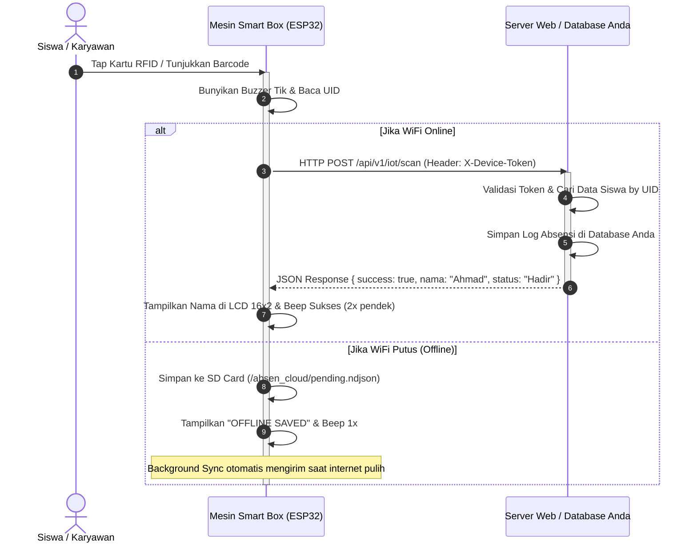

# 📡 Panduan Integrasi Hardware Scanner IoT & API Kontrak (`skillscan.md`)
**Proyek:** Mesin Absensi Smart Box ESP32 (RFID + Barcode/QR 2D)  
**Versi Firmware:** v2.0.0+  
**Protokol Komunikasi:** REST API over HTTPS (JSON Payload) + X-Device-Token  
**Target Pengguna:** Developer Website Sekolah / Aplikasi Kantor Eksternal yang hanya membeli unit Hardware Mesin IoT.

---

## 📑 DAFTAR ISI
1. [Ringkasan Eksekutif](#1-ringkasan-eksekutif)
2. [Alur Komunikasi Data (Architecture Flow)](#2-alur-komunikasi-data-architecture-flow)
3. [Spesifikasi Teknis & Hardware](#3-spesifikasi-teknis--hardware)
4. [Spesifikasi Kontrak API (API Contract)](#4-spesifikasi-kontrak-api-api-contract)
   - [A. Endpoint Utama: Scan Presensi (`POST /api/v1/iot/scan`)](#a-endpoint-utama-scan-presensi-post-apiv1iotscan)
   - [B. Endpoint Heartbeat & Status Online (`POST /api/v1/iot/heartbeat`)](#b-endpoint-heartbeat--status-online-post-apiv1iotheartbeat)
   - [C. Endpoint Cek Update Firmware OTA (`GET /api/v1/iot/firmware-check`)](#c-endpoint-cek-update-firmware-ota-get-apiv1iotfirmware-check)
5. [Struktur Database Minimal di Web Klien](#5-struktur-database-minimal-di-web-klien)
6. [Contoh Implementasi Backend Siap Pakai](#6-contoh-implementasi-backend-siap-pakai)
   - [1. PHP Native / CodeIgniter / WordPress](#1-php-native--codeigniter--wordpress)
   - [2. Laravel 10 / 11 / 12 / 13](#2-laravel-10--11--12--13)
   - [3. Node.js (Express / Fastify)](#3-nodejs-express--fastify)
   - [4. Python (FastAPI / Flask)](#4-python-fastapi--flask)
   - [5. Golang (Gin Framework)](#5-golang-gin-framework)
7. [Penanganan Mode Offline & SD Card Buffer](#7-penanganan-mode-offline--sd-card-buffer)
8. [Panduan Pengujian dengan cURL / Postman](#8-panduan-pengujian-dengan-curl--postman)
9. [Troubleshooting & Indikator LCD / Buzzer](#9-troubleshooting--indikator-lcd--buzzer)

---

## 1. RINGKASAN EKSEKUTIF

Dokumen ini adalah **panduan integrasi lengkap** bagi pengembang sistem atau sekolah yang telah memiliki website/sistem absensi sendiri dan ingin menghubungkannya dengan unit perangkat keras **Mesin IoT Smart Box ESP32**.

Mesin ini bekerja secara mandiri (*standalone*), membaca kartu RFID (MIFARE 13.56 MHz) dan kode QR/Barcode 2D melalui modul kamera optik UART, kemudian mengirimkan data hasil pembacaan ke server web Anda secara *real-time* melalui protokol HTTPS.

---

## 2. ALUR KOMUNIKASI DATA (ARCHITECTURE FLOW)



---

## 3. SPESIFIKASI TEKNIS & VARIAN HARDWARE

Mesin Smart Box ESP32 menggunakan **Universal Single Firmware Architecture** yang secara otomatis mengenali dan menyesuaikan diri dengan modul sensor yang terpasang pada unit fisik:

### 🧩 Varian Perangkat Keras:
1. **Varian COMBO DUAL (RFID + Barcode/QR 2D)**: Dilengkapi modul RFID MFRC522 dan modul kamera GM67 UART. Pengguna bebas men-tap kartu atau men-scan QR. Tampilan LCD Standby: `SILAKAN ABSEN / TAP OR SCAN`.
2. **Varian RFID ONLY**: Khusus membaca kartu absensi MIFARE 13.56 MHz (Kartu Siswa, e-KTP, Tag). Tampilan LCD Standby: `TEMPELKAN KARTU`.
3. **Varian BARCODE / QR ONLY**: Khusus membaca kode QR dari HP atau ID Card barcode 1D. Tampilan LCD Standby: `ARAHKAN KODE QR`.

| Komponen | Spesifikasi | Fungsi & Cakupan Varian |
|---|---|---|
| **Mikrokontroler** | ESP32-WROOM-32D Dual Core 240 MHz | Pemrosesan logika, RTOS multitasking (Semua Varian) |
| **Sensor RFID** | MFRC522 (VSPI) 13.56 MHz | Membaca Kartu Siswa, e-KTP, Gantungan Kunci RFID (Varian RFID & Combo) |
| **Scanner 2D** | GM65 / GM67 / MH-ET UART (9600 Baud) | Membaca Barcode 1D & QR Code layar HP (Varian Barcode & Combo) |
| **Layar Status** | LCD 16x2 I2C (Alamat 0x27) | Menampilkan instruksi jam, nama siswa & status (Semua Varian) |
| **Audio Feedback**| Buzzer Aktif 5V | Notifikasi suara (*Success Beep* / *Error Warning*) |
| **Buffer Antrean**| FreeRTOS In-Memory Queue | *Offline queue buffer* penampung scan saat WiFi reconnect |
| **Real-Time Clock** | RTC DS1302 + Baterai CR2032 | Penjaga waktu akurat saat koneksi internet mati |

---

## 4. SPESIFIKASI KONTRAK API (API CONTRACT)

### A. Endpoint Utama: Scan Presensi (`POST /api/v1/iot/scan`)

Endpoint ini dipanggil oleh ESP32 setiap kali kartu di-tap atau barcode terbaca.

* **URL:** `https://domain-anda.com/api/v1/iot/scan` *(atau URL kustom yang disepakati)*
* **Metode:** `POST`
* **Header Wajib:**
  * `Content-Type: application/json`
  * `X-Device-Token: tok_rahasia_mesin_anda` *(Token otorisasi perangkat)*

#### 📥 Payload JSON dari Mesin ESP32 (Request):
```json
{
  "code": "A1B2C3D4",
  "device_id": "DEV-GERBANG-01",
  "scanned_at": "2026-08-30T07:15:22+07:00",
  "jenis": "RFID"
}
```

| Field | Tipe Data | Wajib? | Keterangan |
|---|---|:---:|---|
| `code` | `string` | **Ya** | UID Kartu RFID (hex) atau String teks isi Barcode/QR. |
| `device_id` | `string` | Opsional | Kode identitas fisik mesin (misal: `GERBANG-UTAMA`). |
| `scanned_at` | `string` | Opsional | Waktu scan format ISO-8601 dari jam RTC mesin. |
| `jenis` | `string` | Opsional | Sensor sumber pembacaan: `"RFID"` atau `"BARCODE"`. |

---

#### 📤 Format Response JSON dari Server Anda:

ESP32 membutuhkan data balasan JSON untuk **menampilkan pesan di LCD 16x2** dan mengatur nada **Buzzer**:

##### 🟢 1. Skenario Sukses Absensi (HTTP 200):
```json
{
  "success": true,
  "status": "Hadir",
  "nama": "Ahmad Fauzi",
  "kelas": "XII RPL 1",
  "jam": "07:15",
  "message": "Absensi Masuk Berhasil"
}
```
* **Tampilan LCD Baris 1:** `Ahmad Fauzi` (Maks 16 karakter)
* **Tampilan LCD Baris 2:** `HADIR - 07:15`
* **Feedback Buzzer:** 2x Beep Pendek (*Nada Sukses*)

##### 🟡 2. Skenario Belum Waktu Pulang / Terlalu Cepat Tap Ulang (HTTP 200 atau 422):
```json
{
  "success": false,
  "status": "Ditolak",
  "nama": "Ahmad Fauzi",
  "message": "Belum Waktu Pulang (14:00)"
}
```
* **Tampilan LCD Baris 1:** `Ahmad Fauzi`
* **Tampilan LCD Baris 2:** `BLM WAKTU PULANG`
* **Feedback Buzzer:** 1x Beep Panjang

##### 🔴 3. Skenario Kartu Tidak Dikenal / Belum Terdaftar (HTTP 404 atau 422):
```json
{
  "success": false,
  "status": "Gagal",
  "nama": null,
  "message": "Kartu Belum Terdaftar"
}
```
* **Tampilan LCD Baris 1:** `KARTU DITOLAK`
* **Tampilan LCD Baris 2:** `Tidak Terdaftar`
* **Feedback Buzzer:** 3x Beep Cepat (*Nada Error*)

---

### B. Endpoint Heartbeat & Status Online (`POST /api/v1/iot/heartbeat`)

Mesin mengirim sinyal *heartbeat* berkala (default: tiap 60 detik) untuk melaporkan kesehatan jaringan dan mensinkronisasi jam.

* **Metode:** `POST`
* **Header:** `X-Device-Token: tok_rahasia_mesin_anda`
* **Request Payload:**
```json
{
  "device_id": "DEV-GERBANG-01",
  "wifi_rssi": -65,
  "fw_version": "v2.0.0",
  "scans_today": 128
}
```
* **Response Server (HTTP 200):**
```json
{
  "success": true,
  "server_time": "2026-08-30T07:15:22+07:00",
  "heartbeat_interval": 60
}
```

---

### C. Layanan Update Firmware OTA Otomatis (`absen.cloud`)
*(Dikelola secara terpusat oleh platform `absen.cloud` — Klien TIDAK perlu membuat endpoint ini).*

Mesin ESP32 secara otomatis memeriksa ketersediaan pembaruan sistem dan patch keamanan ke server pusat `https://ota.absen.cloud` tanpa membebani server web klien. Ketika versi baru dirilis oleh tim teknis kami, mesin akan memperbarui dirinya sendiri secara mandiri di background.

Jika klien ingin mengelola binary OTA sendiri secara khusus (*Private Enterprise*), endpoint opsional berikut dapat diaktifkan:
* **Metode:** `GET /api/v1/iot/firmware-check?current_version=v2.0.0`
* **Response:**
```json
{
  "update_available": true,
  "version": "v2.1.0",
  "download_url": "https://domain-anda.com/firmware/v2.1.0.bin",
  "checksum_sha256": "abcdef123456..."
}
```

---

## 5. STRUKTUR DATABASE MINIMAL DI WEB KLIEN

Anda hanya perlu menambahkan kolom penyimpanan kode kartu ke tabel pengguna yang sudah ada:

```sql
-- 1. Tambahkan kolom identifikasi kartu pada tabel data master Anda
ALTER TABLE users ADD COLUMN rfid_uid VARCHAR(64) UNIQUE NULL AFTER email;

-- 2. Contoh tabel pencatatan kehadiran absensi (jika belum ada)
CREATE TABLE attendances (
    id BIGINT AUTO_INCREMENT PRIMARY KEY,
    user_id BIGINT NOT NULL,
    device_id VARCHAR(50) DEFAULT 'DEV-GERBANG-01',
    metode ENUM('RFID', 'BARCODE') DEFAULT 'RFID',
    status ENUM('Hadir', 'Telat', 'Pulang') NOT NULL,
    scanned_at DATETIME NOT NULL,
    created_at TIMESTAMP DEFAULT CURRENT_TIMESTAMP,
    INDEX idx_user_scan (user_id, scanned_at)
);
```

---

## 6. CONTOH IMPLEMENTASI BACKEND SIAP PAKAI

### 1. PHP Native / CodeIgniter / WordPress
Simpan sebagai `api/scan.php`:

```php
<?php
header('Content-Type: application/json');

// 1. Verifikasi Header X-Device-Token
$headers = getallheaders();
$token = $headers['X-Device-Token'] ?? ($headers['x-device-token'] ?? '');
if ($token !== 'SECRET_TOKEN_SEKOLAH_123') {
    http_response_code(401);
    echo json_encode(['success' => false, 'message' => 'Unauthorized Device Token']);
    exit;
}

// 2. Baca Input JSON
$rawInput = file_get_contents('php://input');
$data = json_decode($rawInput, true);
$code = trim($data['code'] ?? '');

if (empty($code)) {
    http_response_code(400);
    echo json_encode(['success' => false, 'message' => 'Parameter code wajib diisi']);
    exit;
}

// 3. Koneksi Database & Query Data Siswa
$pdo = new PDO('mysql:host=localhost;dbname=db_sekolah;charset=utf8mb4', 'dbuser', 'dbpass');
$stmt = $pdo->prepare('SELECT id, nama_lengkap, kelas FROM siswa WHERE rfid_uid = ? LIMIT 1');
$stmt->execute([$code]);
$siswa = $stmt->fetch(PDO::FETCH_ASSOC);

if (!$siswa) {
    http_response_code(404);
    echo json_encode([
        'success' => false,
        'status'  => 'Gagal',
        'message' => 'Kartu Tidak Terdaftar'
    ]);
    exit;
}

// 4. Simpan Log Presensi
$insert = $pdo->prepare('INSERT INTO attendances (user_id, scanned_at, status) VALUES (?, NOW(), ?)');
$insert->execute([$siswa['id'], 'Hadir']);

// 5. Kirim Balasan ke Layar LCD Mesin
echo json_encode([
    'success' => true,
    'status'  => 'Hadir',
    'nama'    => $siswa['nama_lengkap'],
    'kelas'   => $siswa['kelas'],
    'jam'     => date('H:i'),
    'message' => 'Absensi Berhasil Tercatat'
]);
```

---

### 2. Laravel 10 / 11 / 12 / 13
Tambahkan di `routes/api.php`:

```php
use Illuminate\Http\Request;
use Illuminate\Support\Facades\Route;
use App\Models\Siswa;
use App\Models\Absensi;

Route::post('/v1/iot/scan', function (Request $request) {
    // 1. Validasi Token
    if ($request->header('X-Device-Token') !== config('services.iot.token', 'SECRET_TOKEN_SEKOLAH_123')) {
        return response()->json(['success' => false, 'message' => 'Unauthorized Device'], 401);
    }

    $code = $request->input('code');

    // 2. Cari Siswa by UID Kartu
    $siswa = Siswa::where('rfid_uid', $code)->orWhere('nisn', $code)->first();
    if (! $siswa) {
        return response()->json([
            'success' => false,
            'status'  => 'Gagal',
            'message' => 'Kartu Belum Terdaftar'
        ], 404);
    }

    // 3. Simpan Catatan Absensi
    Absensi::create([
        'siswa_id'   => $siswa->id,
        'scanned_at' => now(),
        'status'     => now()->format('H:i:s') > '07:30:00' ? 'Telat' : 'Hadir',
    ]);

    // 4. Response untuk Layar LCD ESP32
    return response()->json([
        'success' => true,
        'status'  => 'Hadir',
        'nama'    => $siswa->nama_lengkap,
        'kelas'   => $siswa->nama_kelas ?? 'Umum',
        'jam'     => now()->format('H:i'),
        'message' => 'Absensi Hadir Sukses'
    ]);
});
```

---

### 3. Node.js (Express / Fastify)

```javascript
const express = require('express');
const app = express();
app.use(express.json());

const IOT_SECRET_TOKEN = process.env.IOT_SECRET_TOKEN || 'SECRET_TOKEN_SEKOLAH_123';

app.post('/api/v1/iot/scan', async (req, res) => {
  const token = req.headers['x-device-token'];
  if (token !== IOT_SECRET_TOKEN) {
    return res.status(401).json({ success: false, message: 'Unauthorized Device' });
  }

  const { code } = req.body;
  const user = await db.users.findOne({ rfid_uid: code });

  if (!user) {
    return res.status(404).json({
      success: false,
      status: 'Gagal',
      message: 'Kartu Tidak Dikenal',
    });
  }

  await db.attendances.create({
    userId: user.id,
    scannedAt: new Date(),
    status: 'Hadir',
  });

  return res.json({
    success: true,
    status: 'Hadir',
    nama: user.fullName,
    kelas: user.department || '-',
    jam: new Date().toLocaleTimeString('id-ID', { hour: '2-digit', minute: '2-digit' }),
    message: 'Absensi Sukses',
  });
});

app.listen(3000, () => console.log('IoT Server listening on port 3000'));
```

---

### 4. Python (FastAPI / Flask)

```python
from fastapi import FastAPI, Header, HTTPException
from pydantic import BaseModel
from datetime import datetime

app = FastAPI()

class ScanPayload(BaseModel):
    code: str
    device_id: str | None = None
    scanned_at: str | None = None
    jenis: str | None = "RFID"

@app.post("/api/v1/iot/scan")
def process_scan(payload: ScanPayload, x_device_token: str | None = Header(None)):
    if x_device_token != "SECRET_TOKEN_SEKOLAH_123":
        raise HTTPException(status_code=401, detail="Unauthorized Device")
    
    # Query database pencarian user
    user = query_user_by_rfid(payload.code)
    if not user:
        return {
            "success": False,
            "status": "Gagal",
            "message": "Kartu Tidak Terdaftar"
        }
        
    record_attendance(user["id"], "Hadir")
    
    return {
        "success": True,
        "status": "Hadir",
        "nama": user["name"],
        "kelas": user.get("class", "-"),
        "jam": datetime.now().strftime("%H:%M"),
        "message": "Absensi Hadir Sukses"
    }
```

---

### 5. Golang (Gin Framework)

```go
package main

import (
	"net/http"
	"time"
	"github.com/gin-gonic/gin"
)

type ScanRequest struct {
	Code     string `json:"code" binding:"required"`
	DeviceID string `json:"device_id"`
	Jenis    string `json:"jenis"`
}

func main() {
	r := gin.Default()

	r.POST("/api/v1/iot/scan", func(c *gin.Context) {
		token := c.GetHeader("X-Device-Token")
		if token != "SECRET_TOKEN_SEKOLAH_123" {
			c.JSON(http.StatusUnauthorized, gin.H{"success": false, "message": "Unauthorized"})
			return
		}

		var req ScanRequest
		if err := c.ShouldBindJSON(&req); err != nil {
			c.JSON(http.StatusBadRequest, gin.H{"success": false, "message": "Invalid payload"})
			return
		}

		// Logika pencarian database di sini...
		c.JSON(http.StatusOK, gin.H{
			"success": true,
			"status":  "Hadir",
			"nama":    "Budi Santoso",
			"kelas":   "XI IPA 2",
			"jam":     time.Now().Format("15:04"),
			"message": "Absensi Sukses",
		})
	})

	r.Run(":8080")
}
```

---

## 7. PENANGANAN MODE OFFLINE & SD CARD BUFFER

Ketika WiFi sekolah mati atau jaringan internet bermasalah:
1. **Penyimpanan Lokal:** ESP32 tidak akan membatalkan absensi. Data scan disimpan secara persisten ke berkas SD Card `/absen_cloud/pending.ndjson`.
2. **Indikator LCD:** Layar LCD akan menampilkan pesan `[OFFLINE SAVED]`. Siswa tetap dapat melanjutkan antrean tap kartu tanpa jeda.
3. **Background Auto-Sync:** Begitu koneksi WiFi pulih, *Background Task* (FreeRTOS Core 0) secara bertahap mengirimkan data antrean ke endpoint `/api/v1/iot/scan` server Anda lengkap dengan timestamp asli saat kartu di-tap.

---

## 8. PANDUAN PENGUJIAN DENGAN CURL / POSTMAN

Sebelum mesin fisik dikirim/dihubungkan, Anda dapat menguji endpoint backend Anda menggunakan perintah `curl` berikut di terminal:

```bash
curl -X POST https://domain-anda.com/api/v1/iot/scan \
  -H "Content-Type: application/json" \
  -H "X-Device-Token: SECRET_TOKEN_SEKOLAH_123" \
  -d '{
    "code": "A1B2C3D4",
    "device_id": "DEV-TEST-01",
    "jenis": "RFID"
  }'
```

---

## 9. TROUBLESHOOTING & INDIKATOR LCD / BUZZER

| Status LCD Baris 1 & 2 | Bunyi Buzzer | Penyebab Masalah | Solusi / Tindakan |
|---|---|---|---|
| `WIFI CONNECTING..` / `WIFI DISCONNECTED` | Tidak berbunyi | SSID / Password WiFi sekolah salah atau sinyal lemah. | Dekatkan mesin ke router atau cek konfigurasi WiFi. |
| `HTTP ERR: 401` / `UNAUTHORIZED` | 3x Beep Cepat | Header `X-Device-Token` di firmware tidak cocok dengan server. | Samakan token di `.env` backend Anda. |
| `HTTP ERR: 404` / `NOT FOUND` | 3x Beep Cepat | URL Endpoint `/api/v1/iot/scan` belum dibuat di server. | Buat route controller di backend sesuai spesifikasi di atas. |
| `KARTU DITOLAK` / `TIDAK DIKENAL` | 1x Beep Panjang | Nomor RFID / Barcode belum diinput admin ke data siswa. | Daftarkan UID kartu di menu master user website Anda. |
| `BERHASIL: [Nama]` / `HADIR - [Jam]` | 2x Beep Pendek | Data berhasil diterima dan tersimpan di database server. | Normal (Operasional Berjalan Lancar). |

---

> **Catatan Pengiriman Mesin:**  
> Saat memesan unit Mesin IoT Smart Box, Anda cukup menyerahkan **Domain URL Server (HTTPS)** dan **Token Rahasia** yang Anda kehendaki kepada kami agar kami dapat meng-*upload* konfigurasi tersebut ke *firmware* unit sebelum mesin dikirimkan ke lokasi Anda.
